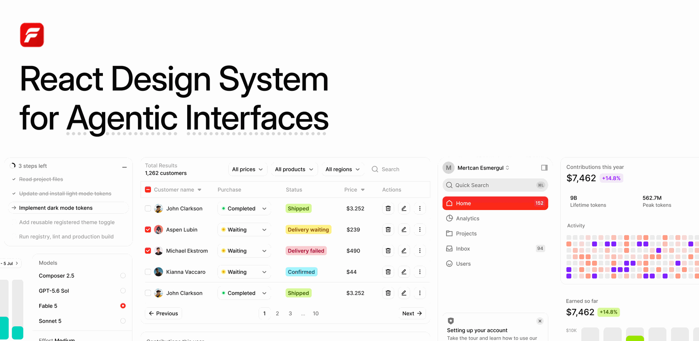

<a href="https://www.faang.com"></a>

# Faang

[](https://www.npmjs.com/package/faang)
[](https://www.npmjs.com/package/faang)
[](LICENSE)
[](https://x.com/faang)
[](https://discord.gg/azcHkw8T6F)

Faang is a React design system for agentic interfaces: the parts an AI product needs and the parts every dashboard needs, in one visual language, as source files in your project. This repository is the whole free tier, and its homepage is a working AI chat on your own model key.

[](https://vercel.com/new/clone?repository-url=https%3A%2F%2Fgithub.com%2FFaang%2Ffaang&env=AI_API_KEY&envDescription=Your+model+provider+key%3A+OpenAI%2C+Anthropic%2C+Google%2C+OpenRouter%2C+or+Vercel+AI+Gateway.+The+provider+is+read+from+the+key+itself.&envLink=https%3A%2F%2Fwww.faang.com%2Fcomponents%2Fchat-starter&project-name=faang-chat-starter&repository-name=faang-chat-starter)

Click the button, paste one API key when Vercel asks for it, and the first deploy already answers.

This repository is generated from Faang's source and takes no pull requests. See [CONTRIBUTING.md](CONTRIBUTING.md).

## Why Faang?

- **Built for agent products.** Chat, thinking indicator, agent log, composer and sidebar, next to the tables, cards and forms around them.
- **Source, not a dependency.** `npx faang add` copies the files into your project. Change anything.
- **One visual language.** Figma first, 400+ semantic tokens, light and dark from the same classes.
- **Accessible by default.** React Aria Components underneath, Tailwind CSS v4 on top, no runtime CSS.
- **RTL Support.** Direction-aware layouts, keyboard navigation, and overlays for Arabic, Hebrew, and other right-to-left languages.
- **Agent-native.** MCP server, agent skill, `AGENTS.md` rules and `llms.txt`, so coding agents build with the system.

## What's in this repository

- All 69 free items as source: base components, application blocks, tokens and type scale. The catalogue is below.
- The app: a chat at `/`, a dashboard with the two free charts, and sign-in and sign-up screens, all built from the components in this repository. Chat history stays in the visitor's browser. No database.
- `app/api/chat/route.ts`, which reads your key server-side and streams replies. The key never reaches the browser.

## Bring your own key

One variable. The provider is read from the key itself:

| Key looks like | Provider | Default model |
| --- | --- | --- |
| `sk-ant-...` | Anthropic | claude-haiku-4-5 |
| `sk-or-...` | OpenRouter | openai/gpt-5-nano |
| `sk-...` | OpenAI | gpt-5.4-mini |
| `AIza...` | Google Gemini | gemini-2.5-flash |
| `vck_...` | Vercel AI Gateway | openai/gpt-5-nano |
| `gsk_...` | Groq | llama-3.3-70b-versatile |
| `xai-...` | xAI | grok-4-fast-non-reasoning |

Create the key with a spending limit where the provider offers one: OpenRouter can cap the credits a key may spend, OpenAI has usage limits per project. The key never reaches the browser, but the chat itself is open to anyone who has your URL, so the cap is what bounds the cost.

Set `CHAT_MODEL` to use a different model. For Mistral or DeepSeek, whose keys have no recognisable shape, add `AI_PROVIDER=mistral` or `AI_PROVIDER=deepseek`. For any OpenAI-compatible server (Ollama, LM Studio, vLLM, LiteLLM, Together) set `AI_BASE_URL` and `CHAT_MODEL`. Every provider's usual variable (`OPENAI_API_KEY`, `ANTHROPIC_API_KEY`, ...) works too. See `.env.example`.

## Run it locally

```bash
npm install
cp .env.example .env.local   # then put your key in AI_API_KEY
npm run dev
```

## Install into an existing project

Every component in this repository also installs on its own, as source, into any Next.js project.

### With an agent

Faang has an MCP server, so Claude Code, Cursor and any MCP client can browse the catalog and install for you. Add it once:

```bash
claude mcp add faang -- npx -y faang@latest mcp
```

Cursor and most other clients take the same server in their MCP config:

```json
{
  "mcpServers": {
    "faang": { "command": "npx", "args": ["-y", "faang@latest", "mcp"] }
  }
}
```

Then ask in plain words. "Install every free Faang component" installs the whole free catalog in one go. "Add a data table and stat cards to the dashboard" installs just those and wires them in. The rules in `AGENTS.md` keep whatever it builds on Faang's tokens and type scale. Setup for VS Code, Codex and the rest is at [faang.com/mcp](https://www.faang.com/mcp).

### With the CLI

```bash
npx faang@latest list              # every component, one line each
npx faang@latest add data-table    # one component and what it depends on
npx faang@latest add --all         # everything in this repository
```


## RTL Support

Faang supports Arabic, Hebrew, and other right-to-left languages with the same component source. The app already uses `DirectionProvider` in `app/layout.tsx`. To switch the whole app to Arabic, change the document and provider together:

```tsx
import { DirectionProvider } from "@/components/foundations/direction/direction";

export default function RootLayout({ children }: { children: React.ReactNode }) {
  return (
    <html lang="ar" dir="rtl">
      <body>
        <DirectionProvider locale="ar">{children}</DirectionProvider>
      </body>
    </html>
  );
}
```

Keep the existing font classes, metadata, and theme script when updating your layout. Use `he` for Hebrew, or `en-US` with `dir="ltr"` for English. Choose a font with Arabic or Hebrew coverage. Nest providers for regions in another language; CSS direction alone does not configure React Aria keyboard navigation, calendars, or portalled menus.

In an existing project, install the foundation with `npx faang@latest add direction`. Use logical styles such as `ps`/`pe`, `ms`/`me`, `start`/`end`, and `text-start`/`text-end` for your own layouts. Mirror navigation arrows and drawer motion, and pass `dir={useDirection()}` to custom portal roots. Keep email addresses, URLs, code, and OTP digits in LTR regions; their fields still align with the surrounding layout.

Translate labels, placeholders, and accessible names in your application's translation layer, and use `Intl` for dates, numbers, and currencies. The optional `template-copy` foundation provides `TemplateCopyProvider` for translating display copy. Direction and translation are configured separately; Chinese (`zh-CN`) uses LTR.

When working with an agent, ask it to read the `direction` component and usage examples, install it, and configure the matching document and provider locale. The rules in `AGENTS.md` and `.cursor/rules/faang.mdc` include the direction conventions. For an older installation, preserve your customizations before refreshing component source and global styles.

See the [RTL setup guide and live Arabic/Hebrew examples](https://www.faang.com/rtl).

The live examples use the actual Auth Card, Date Range Picker, Radio Cards, and Checkbox components. For example, these preferences show both checkbox states in Arabic:

```tsx
"use client";

import { DirectionProvider } from "@/components/foundations/direction/direction";
import { Checkbox } from "@/components/base/checkbox/checkbox";
import { SegmentedControl, SegmentedControlItem } from "@/components/base/segmented-control/segmented-control";

export function Preferences() {
  return (
    <DirectionProvider locale="ar">
      <div className="flex flex-col gap-4">
        <SegmentedControl aria-label="الفترة" defaultSelectedKeys={["weekly"]}>
          <SegmentedControlItem id="daily">يومي</SegmentedControlItem>
          <SegmentedControlItem id="weekly">أسبوعي</SegmentedControlItem>
          <SegmentedControlItem id="monthly">شهري</SegmentedControlItem>
          <SegmentedControlItem id="yearly">سنوي</SegmentedControlItem>
        </SegmentedControl>
        <Checkbox defaultSelected>إشعارات البريد الإلكتروني</Checkbox>
        <Checkbox>تحديثات المنتج</Checkbox>
      </div>
    </DirectionProvider>
  );
}
```

For Hebrew, use `locale="he"` with the labels `התראות בדוא״ל` and `עדכוני מוצר`. The first checkbox starts checked; the second starts unchecked. Both remain interactive and follow the provider's direction.


## Components

### Application blocks

Composed screens and panels: sidebars, chat, tables, settings, cards.

| Component | What it is | Install |
| --- | --- | --- |
| [Agent Chat](https://www.faang.com/components/chat-starter) | A working chat app: app sidebar, streaming replies, thinking indicator, a composer pill with stop control, a chat-history rail with local thread switching, and a setup notice when no provider key is set. | `npx faang@latest add agent-chat` |
| [Agent Log](components/application/agent-log/agent-log.tsx) | Shared streaming-log machinery: the reveal ticker, the blur-in with its soft clipping edge, and the curved tree guide that draws itself. Behind Task List and Web Search. | `npx faang@latest add agent-log` |
| [Agent Thinking](https://www.faang.com/components/agent-thinking) | Agent thinking indicator for chat composers — dot wave, dot spin, stars, and infinity variants with a shimmering label and elapsed timer. | `npx faang@latest add agent-thinking` |
| [App Shell](components/application/app-shell/app-shell.tsx) | Page frame for the chat starter: the sidebar, a phone drawer, and a titled content card, carrying the starter's own navigation so the sidebar only links to pages the app has. | `npx faang@latest add app-shell` |
| [Auth Card](https://www.faang.com/components/auth-card) | Sign-in and sign-up cards with social providers stacked with labels or inline as icons, plus email fields and a CTA. | `npx faang@latest add auth-card` |
| [Composer Loader](https://www.faang.com/components/composer-loader) | Loading state that wraps a chat composer — an iridescent light band orbiting the rim with a soft inward bloom, fading in while the agent works. | `npx faang@latest add composer-loader` |
| [Data Grid](https://www.faang.com/components/data-grid) | Virtualized spreadsheet with editable cells, range selection, filters, resizable columns, undo and redo, summaries, and CSV export. | `npx faang@latest add data-grid` |
| [Data Table](https://www.faang.com/components/data-table) | TanStack-powered data table with sorting, selection, and pagination. | `npx faang@latest add data-table` |
| [Important Alerts Card](https://www.faang.com/components/medical-profile) | Scrollable alert feed with tinted icon circles and date pills. | `npx faang@latest add important-alerts-card` |
| [Notification Center](https://www.faang.com/components/notification-center) | Tabbed activity inbox with grouped notifications, unread state, avatars, status icons, and inline actions. | `npx faang@latest add notification-center` |
| [Orders Chart Card](https://www.faang.com/components/orders-chart-card) | Free chart card: a year of monthly orders as bars, this year beside last year for every month, with a count-up headline, delta chip and hover readout. | `npx faang@latest add orders-chart-card` |
| [Patient Info Card](https://www.faang.com/components/medical-profile) | Profile card with avatar and label/value detail rows. | `npx faang@latest add patient-info-card` |
| [Revenue Chart Card](https://www.faang.com/components/revenue-chart-card) | Free chart card: a year of monthly revenue as an area against the year before, with a count-up headline, delta chip and hover readout per month. | `npx faang@latest add revenue-chart-card` |
| [Settings Modal](https://www.faang.com/components/settings-modal) | Controlled multi-page settings dialog with General, Profile, Tools, and Storage views. | `npx faang@latest add settings-modal` |
| [Sidebar](https://www.faang.com/components/sidebar) | The floating dashboard sidebar with team menu, nav, announcement, and user menu. | `npx faang@latest add sidebar` |
| [Stat Cards](https://www.faang.com/components/stat-cards) | KPI stat card row with delta chips. | `npx faang@latest add stat-cards` |
| [Theme Toggle](https://www.faang.com/components/theme-toggle) | Manual light/dark control with a click-origin reveal, local persistence, and no system-theme dependency. | `npx faang@latest add theme-toggle` |

### Base components

The everyday building blocks.

| Component | What it is | Install |
| --- | --- | --- |
| [Announcement](https://www.faang.com/components/announcement) | Dismissible announcement card used in the sidebar footer. | `npx faang@latest add announcement` |
| [Avatar](https://www.faang.com/components/avatar) | Image or initials avatar in multiple sizes and tints. | `npx faang@latest add avatar` |
| [Badge](https://www.faang.com/components/badge) | Counter pills and the Kbd shortcut hint. | `npx faang@latest add badge` |
| [Breadcrumb](https://www.faang.com/components/breadcrumb) | Icon-capable breadcrumb trail. | `npx faang@latest add breadcrumb` |
| [Button](https://www.faang.com/components/button) | Primary, secondary, ghost, and danger buttons in three sizes with icon support. | `npx faang@latest add button` |
| [Button Group](https://www.faang.com/components/button-group) | Row of secondary-style buttons fused into one bordered control with hairline dividers and selectable items. | `npx faang@latest add button-group` |
| [Carousel](https://www.faang.com/components/carousel) | Gallery carousel built on CSS scroll-snap: swipe, arrows and a position indicator. | `npx faang@latest add carousel` |
| [Checkbox](https://www.faang.com/components/checkbox) | React Aria checkbox with animated tick and indeterminate state. | `npx faang@latest add checkbox` |
| [Checkbox Card](https://www.faang.com/components/checkbox) | Bordered selectable card driven by a checkbox. | `npx faang@latest add checkbox-card` |
| [Chip](https://www.faang.com/components/chip) | Status/delta chips in bold and soft variants across the accent palette. | `npx faang@latest add chip` |
| [Close Button](https://www.faang.com/components/close-button) | Compact dismiss button for banners, modals, and chips. | `npx faang@latest add close-button` |
| [Date Picker](https://www.faang.com/components/date-picker) | Single-date picker with month navigation, built on React Aria. | `npx faang@latest add date-picker` |
| [Date Range Picker](https://www.faang.com/components/date-picker) | Two-month range picker sharing the date-picker chrome. | `npx faang@latest add date-range-picker` |
| [Divider](https://www.faang.com/components/divider) | Horizontal content divider with single-line, double-line, filled, and aligned variants. | `npx faang@latest add divider` |
| [Dropdown](https://www.faang.com/components/dropdown) | Composable popover menu (trigger, panel, groups, rows, dividers) built on React Aria — the recipe behind the sidebar team/account menus. | `npx faang@latest add dropdown` |
| [File Upload](https://www.faang.com/components/file-upload) | Drag-and-drop file upload with validation, animated progress, and a completion callback. | `npx faang@latest add file-upload` |
| [Icon Button](https://www.faang.com/components/icon-button) | Square icon-only button in two sizes. | `npx faang@latest add icon-button` |
| [Input](https://www.faang.com/components/input) | Text input with label, hint text, error states, and leading icon support. | `npx faang@latest add input` |
| [Input OTP](https://www.faang.com/components/input-otp) | One-time-code field with a monospace box per digit, paste distribution and autofill support. | `npx faang@latest add input-otp` |
| [Kbd](https://www.faang.com/components/badge) | Keyboard shortcut hint pill. | `npx faang@latest add kbd` |
| [Link Button](https://www.faang.com/components/link-button) | Inline text action styled like a link — primary/secondary variants, three sizes, icon support, renders <a> or <button>. | `npx faang@latest add link-button` |
| [Meeting Scheduler](https://www.faang.com/components/date-picker) | Date + time-slot scheduler popover. | `npx faang@latest add meeting-scheduler` |
| [Notification](https://www.faang.com/components/notification) | Dismissible notification with status icons, avatars, action buttons, and timed countdown. | `npx faang@latest add notification` |
| [Pagination](https://www.faang.com/components/pagination) | Numbered pagination with prev/next and ellipsis collapsing. | `npx faang@latest add pagination` |
| [Radio](https://www.faang.com/components/radio) | React Aria radio group with the gradient selected dot, two sizes, and the bare RadioDot glyph for menu rows. | `npx faang@latest add radio` |
| [Radio Card](https://www.faang.com/components/radio) | Bordered selectable card driven by a radio — the radio flavor of Checkbox Card. | `npx faang@latest add radio-card` |
| [Segmented Control](https://www.faang.com/components/segmented-control) | Pill-style segmented control (Weekly / Monthly / Yearly switchers). | `npx faang@latest add segmented-control` |
| [Select](https://www.faang.com/components/select) | React Aria select with styled trigger, non-modal popover, and free-form item content. | `npx faang@latest add select` |
| [Slider](https://www.faang.com/components/slider) | Single-value and min/max range sliders with exact-value bubbles and keyboard controls. | `npx faang@latest add slider` |
| [Social Button](https://www.faang.com/components/social-button) | Sign-in buttons for 24 providers, with brand logos, three colour treatments and an icon-only form. | `npx faang@latest add social-button` |
| [Status Dot](https://www.faang.com/components/chip) | Colored status indicator dot used inside selects and tables. | `npx faang@latest add status-dot` |
| [Switch](https://www.faang.com/components/switch) | Skeuomorphic toggle switch in two sizes. | `npx faang@latest add switch` |
| [Switch Card](https://www.faang.com/components/switch) | Bordered settings row driven by a switch. | `npx faang@latest add switch-card` |
| [Table](https://www.faang.com/components/table) | Static table primitives matching the dashboard tables. | `npx faang@latest add table` |
| [Tabs](https://www.faang.com/components/tabs) | Underline and pill tab variants built on React Aria. | `npx faang@latest add tabs` |
| [Textarea](https://www.faang.com/components/textarea) | Multiline text field with auto-grow, character count, and Input's label, hint and states. | `npx faang@latest add textarea` |
| [Tooltip](https://www.faang.com/components/tooltip) | Light-surface tooltip built on React Aria. | `npx faang@latest add tooltip` |
| [Tree View](https://www.faang.com/components/tree-view) | Nested folders and structured content with expandable branches, selection, guide lines, and keyboard navigation. | `npx faang@latest add tree-view` |

### Foundations

Tokens, type scale, global styles, utilities, and the agent rules.

| Component | What it is | Install |
| --- | --- | --- |
| [Agent rules](.cursor/rules/faang.mdc) | Always-on design rules for AI agents (semantic tokens, type scale, conventions), installed as a Cursor rule file. | `npx faang@latest add rules` |
| [Agent runtime](https://www.faang.com/components/chat-starter) | Streaming chat endpoint for agent templates: one AI_API_KEY from OpenAI, Anthropic, Google, OpenRouter, Groq, xAI or Vercel AI Gateway (or any OpenAI-compatible server by URL), a config probe for unconfigured deploys, and the message contract the Faang chat UI installs against. | `npx faang@latest add agent-runtime` |
| [Chevron icons](https://www.faang.com/components/dropdown) | Custom chevron glyphs (select caret, sortable table headers) matching the Figma strokes. | `npx faang@latest add chevrons` |
| [cx utility](utils/cx.ts) | tailwind-merge wrapper aware of Faang's composite text styles, plus the sortCx helper. | `npx faang@latest add cx` |
| [Direction Provider](https://www.faang.com/rtl#direction-provider) | Locale and layout direction for RTL and LTR regions, React Aria interactions, and portals. | `npx faang@latest add direction` |
| [Directional icons](utils/directional-icon.ts) | Mirrors navigation arrows and sidebar glyphs in RTL while preserving non-directional icons. | `npx faang@latest add directional-icon` |
| [Directional scrolling](utils/scroll-direction.ts) | Logical horizontal scroll offsets and item alignment for RTL and LTR carousels and tab strips. | `npx faang@latest add scroll-direction` |
| [Global styles](styles/globals.css) | Tailwind entry css: dark-mode variant, base resets, component animations, and table styling. Imports theme.css and typography.css. | `npx faang@latest add globals` |
| [Logo](components/foundations/brand/logo.tsx) | Faang's brand mark and horizontal lockup at any size, from the approved artwork in `public/brand/`. Swap the files to rebrand. | `npx faang@latest add logo` |
| [Template copy](components/foundations/template-copy/template-copy.tsx) | Optional application translations for template labels, sample content, and accessible names, preserving identifiers and input values. | `npx faang@latest add template-copy` |
| [Theme tokens](https://www.faang.com/components/color) | Color primitives, semantic tokens (text/background/border/foreground/chart), radii, shadows, and button gradient utilities. | `npx faang@latest add theme` |
| [Typography tokens](https://www.faang.com/components/typography) | The full Figma type scale as composite text-{family}-{weight} Tailwind utilities. | `npx faang@latest add typography` |
| [useCountUp hook](hooks/use-count-up.ts) | Animated rolling number hook used by chart headline figures. | `npx faang@latest add use-count-up` |
| [useDismissOnOutsidePress hook](utils/use-dismiss-on-outside-press.ts) | Closes React Aria popovers on outside press without swallowing the outside click. | `npx faang@latest add use-dismiss-on-outside-press` |

## Faang Pro

Everything in this repository is free and complete. Pro adds the full-page templates and the richer components, 10 templates and 30 components, installed into the same project as source: `npx faang@latest login <key>` once, then `add` as usual. One-off payment, no subscription. See [www.faang.com/#pricing](https://www.faang.com/#pricing).

<details>
<summary>The 10 templates</summary>

| Name | What it is |
| --- | --- |
| [AI Chat Template](https://www.faang.com/components/ai-chat) | Full AI chat app: sidebar, resizable code panel, composer with model/effort controls. |
| [AI Image Generation Template](https://www.faang.com/components/ai-image-generation) | Prompt thread with a live generation frame and feedback actions, plus a gallery panel of past generations. |
| [AI Profile Template](https://www.faang.com/components/ai-profile) | AI contributions profile: cover card with activity heatmap, 30-day agents bar chart, and tokens trend chart. |
| [Finance Dashboard Template](https://www.faang.com/components/finance-dashboard) | Balance KPIs, a cash-flow sankey, spending rings, portfolio bubbles, a daily spending heatmap, and a transactions data table. |
| [Home Dashboard Template](https://www.faang.com/components/home-dashboard) | KPI stat cards, revenue trend, earnings chart, contributions heatmap, and a customers table in a responsive app shell. |
| [HR Management Template](https://www.faang.com/components/hr-management) | Headcount KPIs, recent hires, hiring pipeline, engagement radar, hires vs. attrition, team breakdowns, and an employees data table. |
| [Marketing Dashboard Template](https://www.faang.com/components/marketing-dashboard) | Campaign KPIs, acquisition funnel, spend by channel, traffic sources, ad spend vs. ROAS, visitors by channel, and a campaigns data table. |
| [Medical Report Template](https://www.faang.com/components/medical-profile) | Patient overview with steps, sleep score, activity rings, and most-active-days charts. |
| [Multi-agent Chat Template](https://www.faang.com/components/multi-agent-chat) | Individual and group agent conversations with ten animated paper agents, a live agent creator, and a customizable composer. |
| [Project Board Template](https://www.faang.com/components/project-board) | A responsive kanban workspace with sortable tickets, animated ticket creation and detail panels, editable properties, comments, and token usage charts. |

</details>

<details>
<summary>The 30 components</summary>

| Name | What it is |
| --- | --- |
| [Activity Rings Card](https://www.faang.com/components/activity-rings-card) | Apple Watch-style concentric goal rings with stat tiles. |
| [Agent Avatar](https://www.faang.com/components/multi-agent-chat) | Animated paper avatars with wandering eyes, expressive faces, nine silhouettes, and dimensional turn animations. |
| [Agent Creator](https://www.faang.com/components/agent-creator) | A controlled agent creator sidebar with animated avatars, emotion and shape pickers, custom colors, profile fields, and voice preferences. |
| [Agent Limits Card](https://www.faang.com/components/agent-limits-card) | Context window usage bar with an expandable token breakdown, collapsible groups, and plan usage limits with reset times. |
| [Agent Progress](https://www.faang.com/components/agent-progress) | Collapsible multi-step AI task progress with animated active, pending, and completed states. |
| [Area Chart Card](https://www.faang.com/components/area-chart-card) | Multi-series area chart with stacked, overlapping and 100% variants, gradient fills, period dropdown and stat tiles. |
| [Bar List Card](https://www.faang.com/components/bar-list-card) | Analytics breakdown list: ranked rows with share bars behind the labels, tabbed lists, metric caption, and a show-more pill. |
| [Calendar](https://www.faang.com/components/calendar) | Month-view calendar with event chips, details popover, month switcher, and inbox feed. |
| [Combo Chart Card](https://www.faang.com/components/combo-chart-card) | Bar-plus-line combo chart with independent left and right axes, hover dimming, and a pulsing active dot. |
| [Composer](https://www.faang.com/components/composer) | The AI chat composer, whole package: attachment and model menus, voice and send controls, the status bar, and the liquid-glass loading treatment for its controls. |
| [Composer Attachments](https://www.faang.com/components/composer-attachments) | The Composer Panel carrying attachments: image and document tiles above the prompt, landing one after another with the upload ring drawing around each. |
| [Composer Panel](https://www.faang.com/components/composer-panel) | The two-row AI chat composer: prompt on top, add, permission, model, mic and send controls below, and a status tab with branch, project folder and context meter hanging off the card. |
| [Contributions Card](https://www.faang.com/components/contributions-card) | GitHub-style contributions heat grid with swappable accent family. |
| [Earnings Chart Card](https://www.faang.com/components/earnings-chart-card) | Bar chart card with period switcher, count-up headline, and hover outline. |
| [Funnel Chart Card](https://www.faang.com/components/funnel-chart-card) | Horizontal flow funnel with curved or sharp tapers, centred conversion pills, mono option, and a value/name footer under every column. |
| [Heatmap Chart Card](https://www.faang.com/components/heatmap-chart-card) | Matrix heatmap card (rows × columns) with a theme-following ramp, hover-linked headline, and Less → More legend. |
| [Line Chart Card](https://www.faang.com/components/line-chart-card) | Line/area chart card with gradient fill, curved or sharp interpolation, and animated active dot. |
| [Most Active Days Card](https://www.faang.com/components/most-active-days-card) | Continuous vertical month calendar with per-day mini activity rings. |
| [Multi-agent Chat](https://www.faang.com/components/multi-agent-chat) | An agent workspace with individual and group conversations, a live avatar editor, and the Faang composer. |
| [Project Board](https://www.faang.com/components/project-board) | Sortable kanban board with ticket detail side panels, editable properties, comments, purple token charts, and smooth cross-column drag and drop. |
| [Questionnaire](https://www.faang.com/components/questionnaire) | Plan-mode questions as a chat card: one question per step with checkbox or numbered rows, a free-text Other row, step pills and Previous / Next, sliding between questions as the card animates to each one's height. |
| [Radar Chart Card](https://www.faang.com/components/radar-chart-card) | Radar chart card with filled, dotted, lines-only, and centre-score variants, hover-linked headline, and multi-series legend. |
| [Radial Chart Card](https://www.faang.com/components/radial-chart-card) | Radial bar chart card: concentric rings (plain, labelled, or over a grid), single-value gauges, and a stacked half gauge. |
| [Sankey Chart Card](https://www.faang.com/components/sankey-chart-card) | Sankey flow card with pill nodes, target-tinted links, source and share labels, and hover isolation. |
| [Scatter Chart Card](https://www.faang.com/components/scatter-chart-card) | Scatter and bubble chart with grouped series, an optional size measure, hover isolation and stat tiles. |
| [Sleep Score Card](https://www.faang.com/components/sleep-score-card) | Segmented score ring with hover-focused sub-scores and metric rows. |
| [Stage Bars Card](https://www.faang.com/components/stage-bars-card) | Funnel stages as rounded horizontal pills with name, value, and share per stage, animated widths, and a mono option. |
| [Steps Card](https://www.faang.com/components/steps-card) | Weekly steps bar chart with week switcher, count-up headline, and hover outline. |
| [Task List](https://www.faang.com/components/task-list) | Streaming agent task log: tasks reveal step by step with soft height, blur, and a shimmering running title. |
| [Web Search](https://www.faang.com/components/web-search) | Streaming research trail: the queries an agent ran and the sources it opened, with real site marks. |

</details>

## Before going public

Requests bill to whoever owns the key, and anyone who has your URL can send them. Three ways to bound that, simplest first: create the key with a spending limit, turn on Vercel's deployment protection for a personal deployment, and put a rate limit in front of `/api/chat` before pointing the internet at it.

## License

[MIT](LICENSE). Use it, change it, ship it, share it. Faang Pro components and templates are sold separately under the [Faang License](https://www.faang.com/license).
